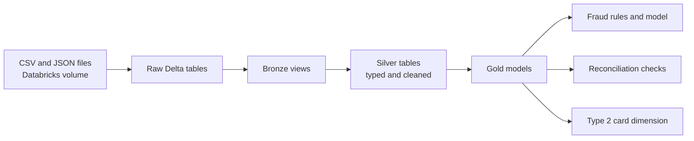

## Hi there, I'm Tajudeen Omotosho 

  <!--  You can customize the typing text in the "lines=" section of the URL below -->
  <!--  For an ampersand (&), use &amp; (e.g., Analytics+%26+Optimization) -->
  

<!-- 🔗 Update these links with your own social media and contact information -->

  
  <!--  --> 
 <!--  -->

## 🚀 About Me 
I started my career in audit and accounting, where the job is to prove that numbers are complete, accurate and explainable. I now apply the same discipline to data engineering: control totals between layers, tested exceptions, point-in-time history, and no hindsight in the analysis.

I also develop clear, dynamic dashboards in Power BI and Tableau that communicate insights effectively to stakeholders. My work is driven by precision, clarity, and a commitment to delivering high-quality analytical solutions.

I am looking for data engineering roles (analytics engineering, data platform, or finance and risk data teams) where that background is an advantage.

 <!--🌐 Replace "your-username" with your actual GitHub username -->
<!--### [🏆 Check Out My Full Portfolio Website](https://your-username.github.io/)-->
      
## 🔭 Featured project

- **💳 Credit Card Reconciliation and Fraud Detection (Databricks + dbt):**
- An end-to-end medallion pipeline (bronze, silver, gold) built with dbt on Databricks. It cleans 13.3 million card transactions, tracks card history with a Type 2 slowly changing dimension, runs internal reconciliation checks, and compares a fraud model with a rule baseline using time-based evaluation.
  

  

 <!-- - **Content Creation:** [e.g., Developing new tutorials on data visualization for my YouTube channel.]-->

## 🌱 Results at a glance
| Area | Result |
|---|---|
| Scale | 13,305,915 transactions, 6,146 cards, 2,000 users (2010 to 2019) |
| Quality | 63 dbt models and tests pass in a full build, including no overlaps, no gaps and one current row per card in the Type 2 dimension |
| Reconciliation | Counts and amounts tie across bronze, silver, gold and the card-month statement. Exceptions carry severities, and 660,049 refunds were matched to purchases |
| Fraud model (2019, scored once) | Caught 85% of fraud against 60% for the best rule, at the same review workload (same 3.3% of transactions flagged) |
| Method | Time-based split, no leakage, rules and model compared at an equal flag rate |
<!-- - [Another skill, e.g., Cloud data warehousing with Google BigQuery.]-->

## 🛠️ Technical Skillset

<!-- This section uses Shields.io badges. You can customize them or create your own!-->

#### Data Analysis & Visualization

  <!-- 💡 Go to Shields.io to create your own badges A/B Testing Skill Badg-->
  
  
  
  

#### Programming & Automation

  

#### Business Intelligence & Analytics

  <!---->
  
  
  

## 👋 Professional Experience  
#### Audit & Accounting (2008 - 2015)
- Performed accurate bank reconciliations, ensuring 100% alignment with internal records.
- Produced cashbooks, trial balances, and final accounts, reducing month-end close by 30% using advanced Excel.
- Delivered accurate, client-focused financial reporting.
  
#### Software & Web Developer (2015 – 2021)
- Developed multiple websites and collaborated on web applications using PHP and MySQL.
- Built data-driven application features and improved system performance.
- Worked with distributed teams using digital tools for planning and deployment.
